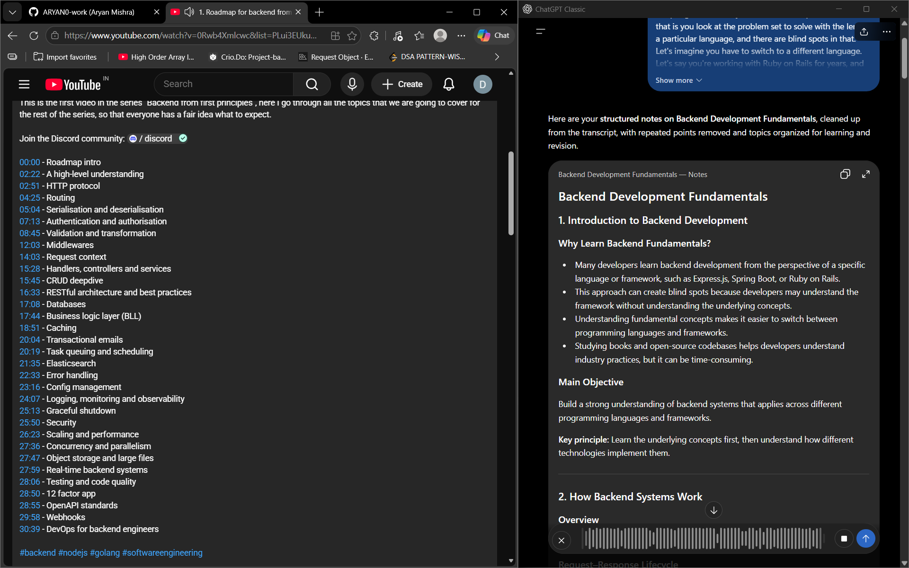

> This is gonna be the roadmap

# Backend Development Fundamentals

## 1. Introduction to Backend Development

### Why Learn Backend Fundamentals?

* Many developers learn backend development from the perspective of a specific language or framework, such as Express.js, Spring Boot, or Ruby on Rails.
* This approach can create blind spots because developers may understand the framework without understanding the underlying concepts.
* Understanding fundamental concepts makes it easier to switch between programming languages and frameworks.
* Studying books and open-source codebases helps developers understand industry practices, but it can be time-consuming.

### Main Objective

Build a strong understanding of backend systems that applies across different programming languages and frameworks.

**Key principle:** Learn the underlying concepts first, then understand how different technologies implement them.

---

## 2. How Backend Systems Work

### Overview

A backend system enables communication between clients and servers.

* Request–response communication

**Goal:** Understand how a request travels from a client to a backend server and how the response returns.

---

## The Main Takeaway

The objective is not simply to learn how to build APIs using a particular framework.

It is to understand **why backend systems are designed the way they are**.

Once you understand the underlying concepts, you can apply that knowledge across Express.js, Spring Boot, Ruby on Rails, Go and other backend technologies.
