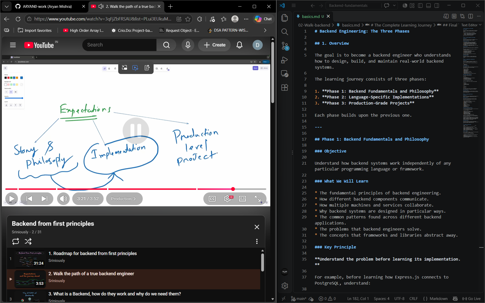

# Backend Engineering: The Three Phases

## 1. Overview

The goal is to become a backend engineer who understands how to design, build, and maintain real-world backend systems.

The learning journey consists of three phases:

1. **Phase 1: Backend Fundamentals and Philosophy**
2. **Phase 2: Language-Specific Implementations**
3. **Phase 3: Production-Grade Projects**

Each phase builds upon the previous one.

---

## Phase 1: Backend Fundamentals and Philosophy

### Objective

Understand how backend systems work independently of any particular programming language or framework.

### What We Will Learn

* The fundamental principles of backend engineering.
* How different backend components communicate.
* How multiple machines and services collaborate.
* Why backend systems are designed in particular ways.
* The common patterns found across different backend applications.

### Key Principle

**Understand the problem before learning its implementation.**

For example, before learning how Express.js connects to PostgreSQL, understand:

* Why applications need databases.
* How applications communicate with databases.
* What database connections are.
* How database migrations work.

These concepts remain relevant even if you switch programming languages.

---

## Phase 2: Language-Specific Implementations

### Objective

Learn how to implement the concepts from Phase 1 using a particular programming language and its ecosystem.

The two ecosystems covered in the original learning plan are:

* **Node.js**
* **Go (Golang)**

### What We Will Learn

Each fundamental concept will be explored through practical implementations using the selected language.

### Example: Database Integration

**Conceptual learning — Phase 1**

Understand:

* What databases are.
* How applications communicate with databases.
* What database migrations are.
* Why transactions are necessary.
* How connection pooling works.

**Practical implementation — Phase 2**

Learn how to implement these concepts using PostgreSQL.

For Node.js:

* PostgreSQL
* JavaScript/TypeScript
* PostgreSQL.js driver

For Go:

* PostgreSQL
* Go
* pgx driver

The concepts remain similar, but their implementations differ according to the language and its ecosystem.

### Expected Outcome

By the end of this phase, you should be able to translate backend engineering principles into working code using your chosen technology stack.

---

## Phase 3: Production-Grade Projects

### Objective

Combine the concepts and implementations from the first two phases to build complete, real-world backend systems.

### What We Will Do

Build projects from beginning to end while following appropriate engineering standards and best practices.

### What Does Production-Grade Mean?

A production-grade backend is designed to do more than work in a local development environment.

It should be capable of:

* Handling real user requests reliably.
* Managing failures gracefully.
* Protecting user data.
* Maintaining data integrity.
* Supporting future changes.
* Being tested and debugged.
* Scaling as traffic and workload increase.

The goal is to understand how to build systems that can grow from an early-stage startup to a service supporting a substantial number of users.

**Important:** Supporting 100,000 users is not an automatic outcome of completing a roadmap. It depends on the system's workload, architecture, infrastructure, and implementation. The goal is to develop the skills to make informed engineering decisions as a system grows.

### Expected Outcome

By the end of this phase, you should have practical experience designing, implementing, testing, deploying, and maintaining complete backend applications.

---

# The Complete Learning Journey

| Phase   | Focus                            | Main Question                                    |
| ------- | -------------------------------- | ------------------------------------------------ |
| Phase 1 | Fundamentals and philosophy      | Why do backend systems work this way?            |
| Phase 2 | Language-specific implementation | How do we implement these concepts in code?      |
| Phase 3 | Production-grade projects        | How do we combine everything into a real system? |

## Final Takeaway

Becoming a backend engineer is not just about learning Node.js, Go, Express, or a database library.

It requires three levels of understanding:

1. **Conceptual understanding:** Know the principles and problems.
2. **Implementation skills:** Know how to solve those problems using real technologies.
3. **Engineering experience:** Know how to combine those solutions into reliable
