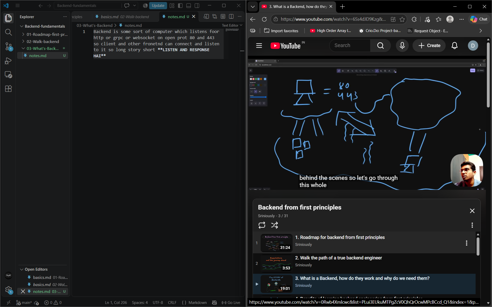

Backend is some sort of computer which listens foor http or grpc or websocket on open prot 80 and 443 so client and other fronetnd can connect and listen to it so long story short **LISTEN AND RESPONSE HAI**

# he had a backend server deployed in AWS

=> go to network tab

do disable cache so we appropriate status

# Let's Trace how req go from here to there 

now open this 

Request URL
https://expense-tracker-with-approvals.onrender.com/health

.onrender => DF
https://expense-tracker-with-approvals => subdf
