Backend is some sort of computer which listens foor http or grpc or websocket on open prot 80 and 443 so client and other fronetnd can connect and listen to it so long story short **LISTEN AND RESPONSE HAI**

# he had a backend server deployed in AWS

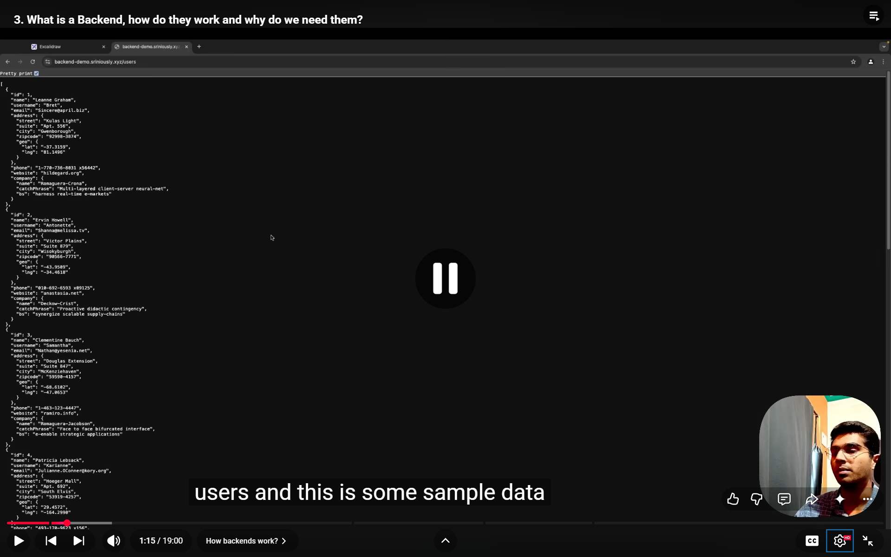

=> go to network tab

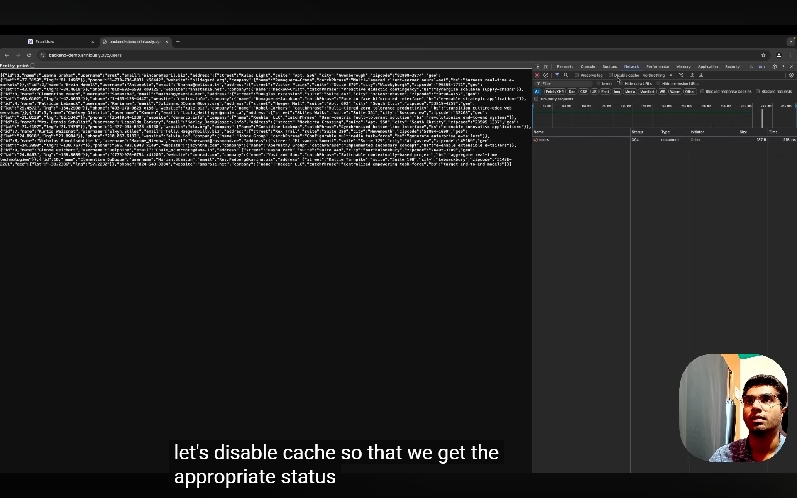

do disable cache so we appropriate status
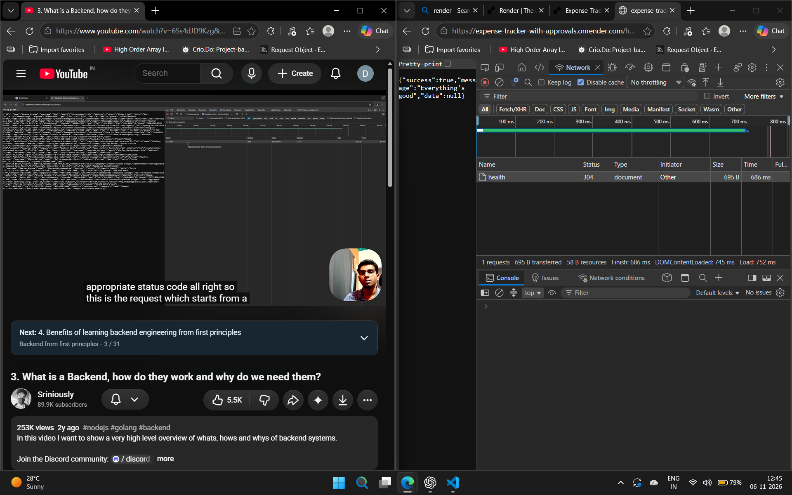

# Let's Trace how req go from here to there 

now open this 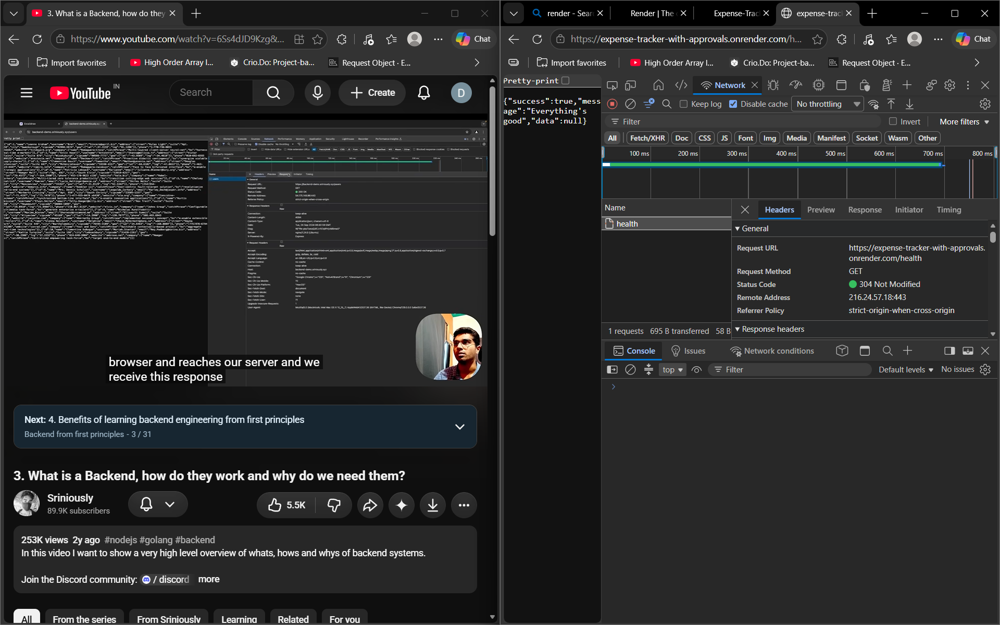

Request URL
https://expense-tracker-with-approvals.onrender.com/health

.onrender => DF
https://expense-tracker-with-approvals => subdf

=> first thing you should do is to see DNS server => this is a dns server 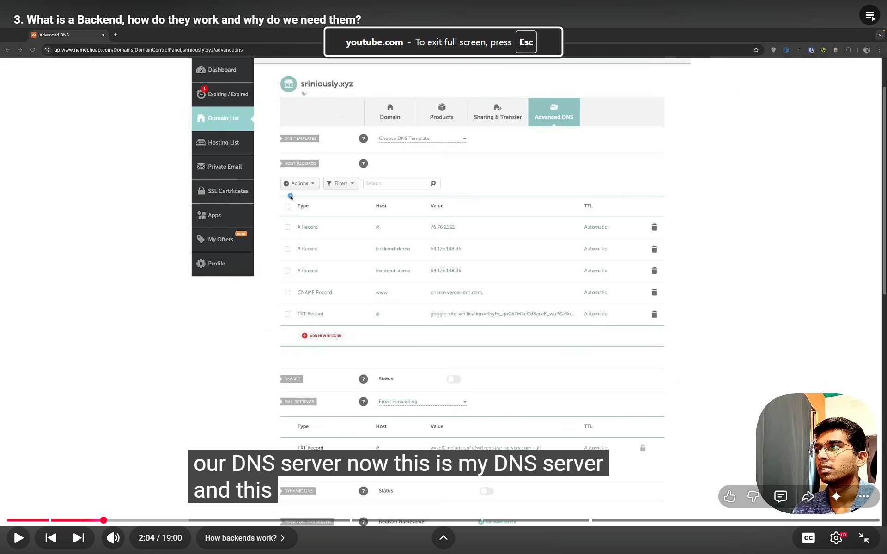

DNS (Domain Name System) records connect domain names to destinations:
- A Record: Points a domain/subdomain to an IP address.
- CNAME Record: Points a domain/subdomain to another domain name.
The focus here is on the two existing A records in the DNS configuration.

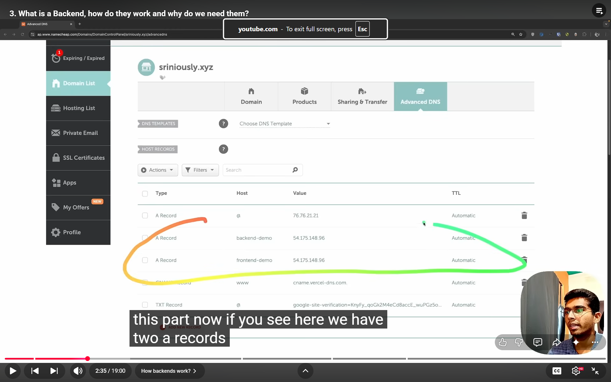

here we have two recods one of them is backend demo which is pointing to a ip and where is this ip address coming from AWS =>

AWS-CONSOL=>

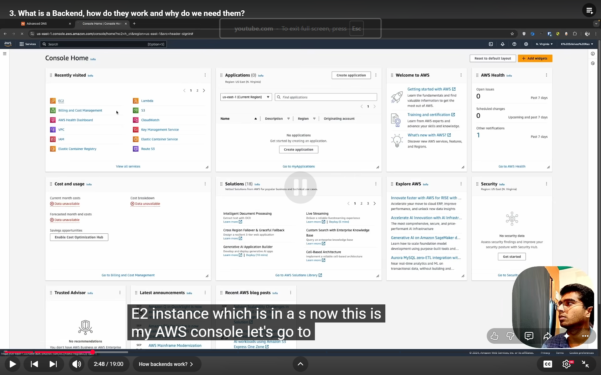

EC2-> instances -> deployed instances

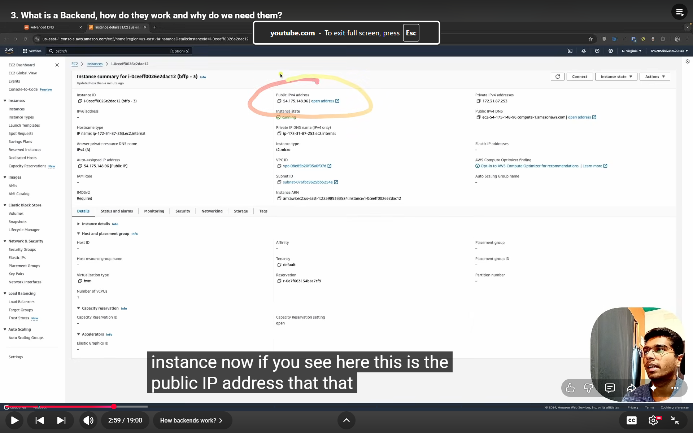

heres the public ip address for uour subdomain which is backend demo points to this ip address 

- The DNS record points to an IP address associated with the EC2 instance.
- Incoming requests reach the EC2 instance through that IP.
- Before reaching the instance, requests pass through the AWS Security Group (firewall).
- Security Groups control which incoming and outgoing requests are allowed through specific ports and protocols.

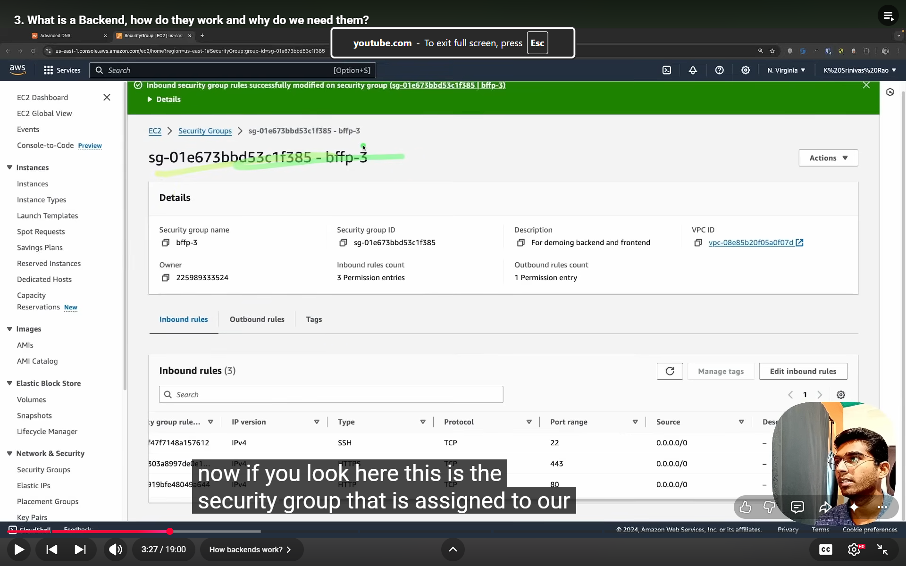

AWS Security Group (Firewall)
- A Security Group acts as a firewall for an AWS EC2/database instance.
- It controls which incoming and outgoing connections are allowed through specific ports.
- Common ports:
  - 22: SSH (terminal access).
  - 80: HTTP.
  - 443: HTTPS.
- When a request reaches the instance's IP address, it must pass through the Security Group.
- If the required port isn't allowed, the firewall blocks the request.
Key takeaway: DNS directs traffic to the server, while the Security Group determines whether that traffic is allowed to reach it.

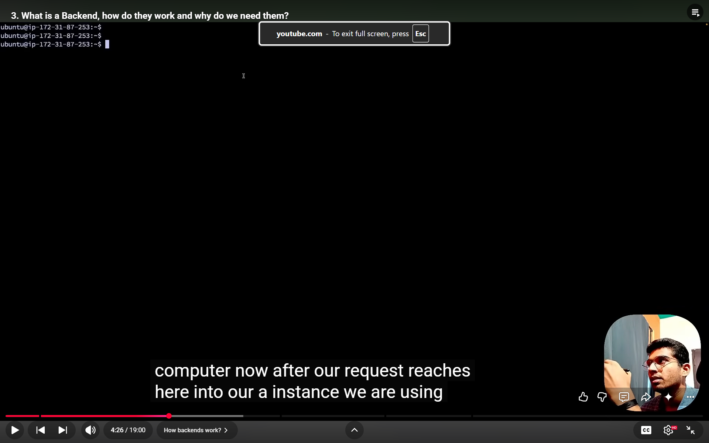

### Nginx (Reverse Proxy) & PM2

- Nginx: Acts as a reverse proxy, sitting in front of our backend server.
- Port 80 → 443: Redirects HTTP requests to HTTPS. Certbot manages SSL certificates.
- Domain Configuration: Nginx listens for requests to backend-demo (our subdomain).
- Request Forwarding: Nginx forwards incoming requests to localhost:3001, where our Node.js backend runs.
- PM2: Manages running Node.js processes, including frontend and backend.
- Testing: curl localhost:3001/users directly accesses the backend and returns the API response.

>Complete Request Flow
Browser → DNS → EC2 Instance → AWS Security Group → Nginx → Node.js Backend (Port 3001) → Response to Browser.

Key takeaway: DNS finds the server, Security Groups allow traffic, Nginx routes requests, and Node.js processes them.

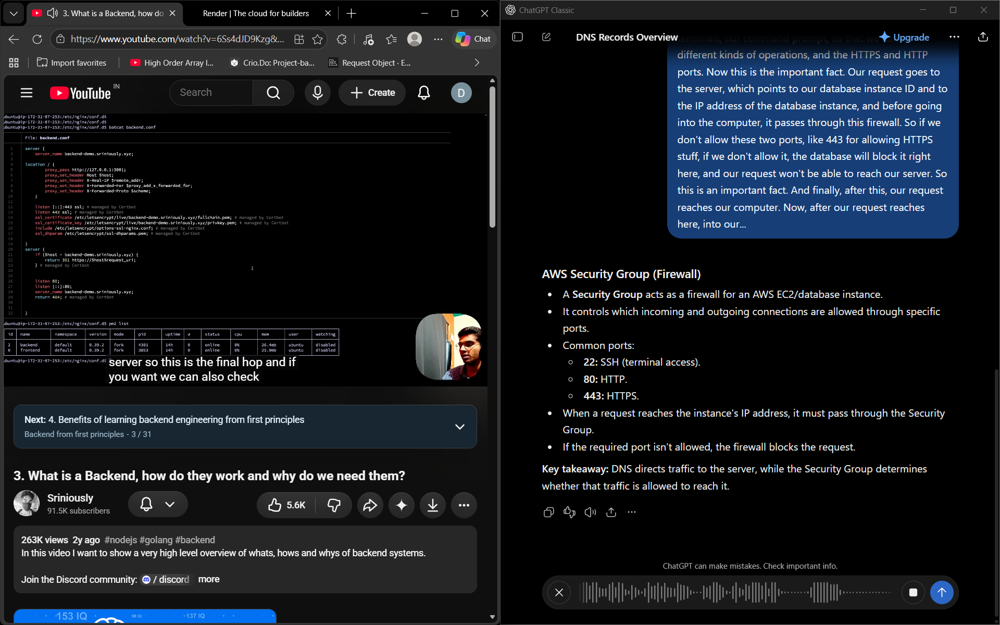

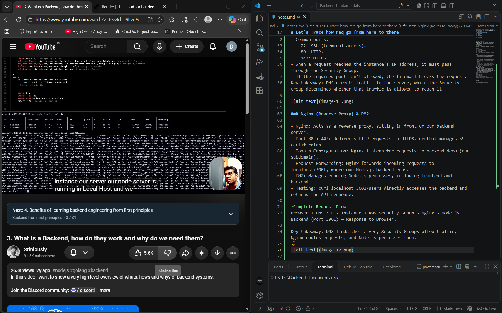

### Complete HTTP Request Flow

When a user sends a request:
1. Browser: User enters the domain name.
2. DNS: Resolves the domain to the server's IP address.
3. AWS: Request reaches the AWS infrastructure.
4. Security Group: Firewall checks whether the required port is allowed.
5. EC2 Instance: Request reaches our instance.
6. Nginx: Acts as a reverse proxy and forwards the request.
7. Node.js Server: Processes the request on localhost:3000 and returns a response.

>Important Points

- Locally, we can directly access localhost:3000 without DNS, AWS or Nginx.
- On AWS, Nginx forwards internet requests to our locally running Node.js server.
- Both approaches ultimately reach the same backend application.
Key takeaway: Understand how an HTTP request travels from a browser over the internet to our backend server.

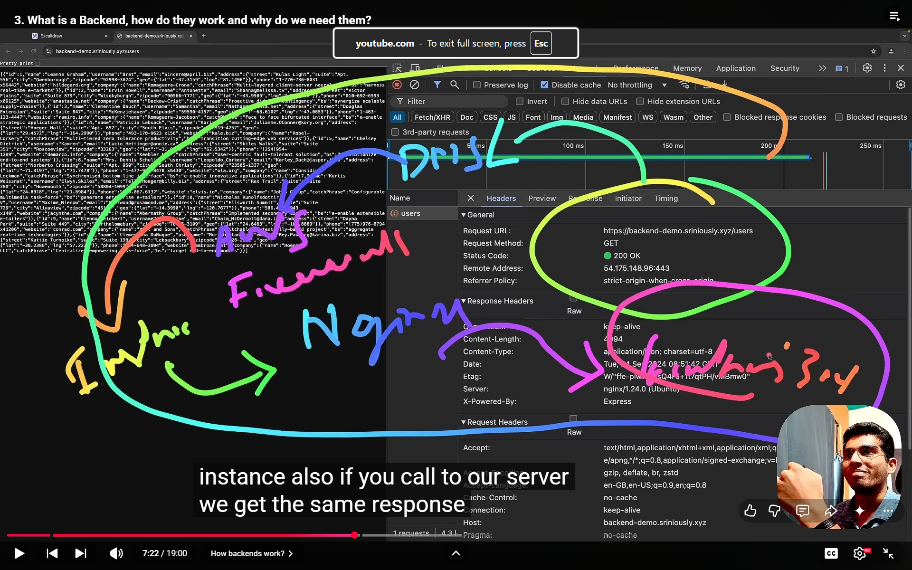

## Why Do We Need a Backend?
Example: Liking a post on Instagram

When you like your friend's post:
1. You click the Like button.
2. The frontend sends a request to the backend.
3. The backend identifies you using your user ID.
4. It saves the like in the database.
5. It identifies the post owner.
6. It triggers a notification for your friend.

## What Does the Backend Actually Do?
The backend primarily handles DATA:

- Fetch: Retrieve data from the database.
- Receive: Accept data from the frontend.
- Persist: Store data permanently.
- Process: Perform operations based on user actions.
- Notify: Trigger notifications and other events.

> Why Not Do Everything on the Frontend?

You might wonder why we don't connect the frontend directly to the database and perform everything there.

The problem is that frontend applications run on users' devices, which creates challenges around security, data consistency, access control and centralized management.

For example:
- Users could manipulate frontend code.
- Database credentials could be exposed.
- Users could access or modify unauthorized data.
- Business logic would be difficult to control centrally.
Key takeaway: The frontend handles user interaction, while the backend handles data, business logic, authentication, authorization and communication with databases.

# How Frontend Works Behind the Scenes (Next.js)

When you open a Next.js website:
1. HTML Request: Browser requests the website's domain and receives an HTML document.
2. Resource Fetching: Browser separately downloads JavaScript, CSS, images and fonts.
3. Rendering: Browser uses HTML and CSS to display the page.
4. Hydration: JavaScript executes and attaches event listeners to buttons and other interactive elements.
5. Interactivity: Buttons, navigation and other interactions start working.

> Nginx Configuration
- Frontend requests are forwarded to localhost:3000.
- Backend requests are forwarded to localhost:3001.
- Nginx acts as a reverse proxy for both.
Important Concepts
- HTML: Defines the page structure.
- CSS: Controls appearance and styling.
- JavaScript: Handles logic and interactivity.
- Hydration: Makes server-rendered HTML interactive by attaching JavaScript functionality.

> Key Takeaway
The frontend is ultimately delivered to and executed by the user's browser.

This means JavaScript and frontend logic are accessible on the user's device, which raises important questions about security and why sensitive operations must be handled by the backend.

# How Frontend JavaScript Executes
1. Frontend vs Backend execution
- Backend: Browser sends a request → Server executes the logic → Server returns the result.
- Frontend: Server sends HTML, CSS and JavaScript → Browser executes the JavaScript on the user's machine.
Key difference: Backend code executes on the server, whereas frontend code executes in the browser.
2. Browser Sandbox
Browsers run JavaScript inside a restricted environment called a sandbox.

# JavaScript has limited access to:
- DOM (Document Object Model).
- Browser APIs (localStorage, cookies, etc.).
- External APIs (subject to browser security policies).
It cannot freely access the user's operating system or filesystem.

3. What is CORS?
CORS (Cross-Origin Resource Sharing) is a browser security mechanism that controls whether frontend JavaScript can access resources from another origin.

Example:
- Frontend: frontend.demo.com
- Backend: backend.demo.com
These are different origins.

The browser checks whether the backend allows requests from the frontend's origin through appropriate CORS headers.

4. Why Does Browser Sandboxing Matter?
Imagine visiting a malicious website.

Without sandboxing, its JavaScript could potentially:
- Access your personal files.
- Steal sensitive information.
- Access operating system resources.
- Send your private data to malicious servers.
Sandboxing and browser security policies help prevent this.
Key Takeaway
Frontend JavaScript runs on an untrusted client device, whereas backend code runs in an environment controlled by the application developer.

This is the fundamental reason we cannot trust the frontend with sensitive backend responsibilities.

# Why Can't We Write Backend Logic in the Frontend?

There are 4 major reasons:
1. Security
- Browsers run JavaScript in a sandbox.
- Frontend cannot freely access the operating system, filesystem or environment variables.
- Sensitive operations and secrets must remain on the backend.
2. CORS Restrictions
- Browsers restrict cross-origin API requests through CORS.
- Backend servers can communicate with external APIs without being subject to browser CORS enforcement.
- This makes backend servers better suited for integrating multiple external services.
3. Database Connectivity
- Backend servers use database drivers such as PostgreSQL (pg) and MongoDB drivers.
- These drivers support efficient database communication and connection pooling.
- Browsers aren't designed to maintain direct database connections.
- Direct database access from every client would also create security and scalability problems.

>Connection Pooling: Maintaining a reusable collection of database connections instead of creating and destroying connections for every request.

4. Computing Power
- Frontend runs on different devices with varying CPU and RAM capabilities.
- Heavy business logic can make weaker devices slow or unresponsive.
- Backend servers provide centralized computing resources.
- We can scale server CPU and memory according to application requirements.

| Frontend | Backend |
|----------|---------|
| Runs in the browser | Runs on the server |
| Handles UI and interactions | Handles business logic |
| Limited system access | Controlled system access |
| Subject to browser CORS restrictions | Not subject to browser CORS enforcement |
| Limited database connectivity | Supports database drivers and pooling |
| Depends on client hardware | Uses centralized server resources |

# The fundamental principle:

Frontend handles presentation and user interactions. Backend handles business logic, data management, security and centralized processing.

This separation is one of the foundations of backend engineering.